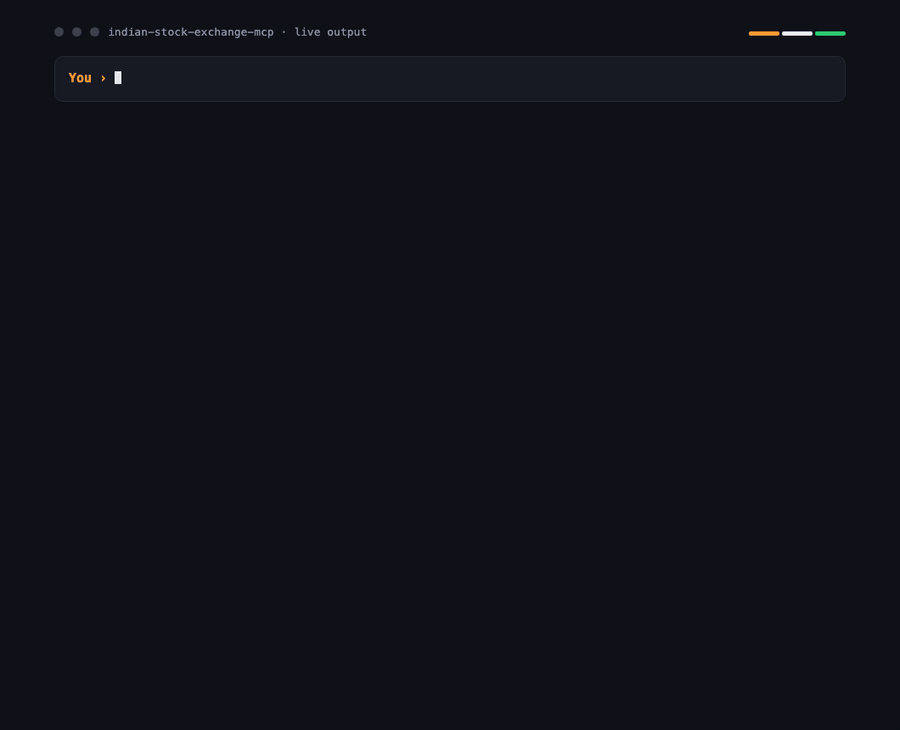

# Indian Stock Exchange MCP Server

An [MCP](https://modelcontextprotocol.io) server that gives Claude (and any MCP client) live access to the Indian market: **NSE/BSE equities, fundamentals, analyst targets, IPOs, mutual funds and commodities**. Ask things like:

- *"Compare TCS, Infosys and Wipro on valuation, margins and momentum."*
- *"Give me a research note on Reliance: financials, shareholding changes, analyst targets and recent filings."*
- *"What's moving the market today? Any IPOs opening this week?"*
- *"Shortlist the best mid-cap mutual funds by 3-year return and compare the top three."*

Data comes from the [Indian Stock Market API](https://indianapi.in/indian-stock-market).



*Real output from the `compare-stocks` tool. Regenerate it with `node scripts/capture-demo.mjs && scripts/render-demo.sh`.*

## Features

- **27 tools**, all read-only and annotated as such, with compact, analysis-ready output instead of raw API dumps
- **One-call stock snapshot**: price, ranges, valuation, profitability, growth, leverage, returns, moving-average trend, analyst consensus and peers
- **Fundamentals**: multi-year P&L, balance sheet, cash flow, ratios, shareholding pattern, analyst estimates and price targets
- **Market**: gainers/losers, most active, price shockers, 52-week highs/lows, news, IPO calendar, commodity futures
- **Mutual funds**: search, browse by category and return, full scheme details
- **5 prompts** (`analyze-stock`, `compare-stocks`, `market-briefing`, `dividend-and-events`, `mutual-fund-picks`) and **3 resources** (news, IPO calendar, `ise://stock/{name}`)
- **Reliable client**: request timeout, retry with backoff on 429/5xx, in-memory TTL cache, in-flight de-duplication, clear error messages, and the API key is never exposed in output
- **stdio** transport for desktop clients and stateless **Streamable HTTP** for remote use

## Tools

| Area | Tool | What it does |
|---|---|---|
| Stocks | `search-stocks` | Resolve a name to NSE/BSE codes and ISIN |
| | `get-stock-snapshot` | Condensed overview of a stock (start here) |
| | `get-stock-price` | Latest price, day range, 52-week range |
| | `get-stock-details` | Profile, key metrics, shareholding, actions, news by section |
| | `get-stock-history` | Price, P/E, P/B, margins or EV history over 1m to max |
| | `compare-stocks` | Side-by-side comparison of 2-5 stocks |
| | `get-peers` | Peer companies with valuation and returns |
| | `get-stock-recommendations` | Analyst rating breakdown and trend |
| Fundamentals | `get-financial-statements` | Quarterly/annual results, balance sheet, cash flow, ratios |
| | `get-shareholding-pattern` | Promoter/FII/DII/public holding over time |
| | `get-analyst-estimates` | Consensus forecasts or actuals (EPS, sales, net income, EBITDA, ROE, ...) |
| | `get-price-target` | Mean/high/low targets and consensus recommendation |
| | `get-corporate-actions` | Dividends, bonus, splits, rights, board meetings |
| | `get-announcements` | Recent exchange filings with links |
| Market | `get-market-overview` | Movers, activity, shockers and headlines in one call |
| | `get-top-gainers` / `get-top-losers` | Today's biggest movers |
| | `get-most-active` | Highest-volume stocks (NSE or BSE) |
| | `get-price-shockers` | Unusual price moves (NSE or BSE) |
| | `get-52-week-highs-lows` | Stocks at 52-week extremes |
| | `get-news` / `get-market-news` | Latest headlines with summaries |
| | `get-ipos` | Upcoming, active, closed and listed IPOs |
| | `get-commodities` | MCX futures with open-interest signal |
| Mutual funds | `search-mutual-funds` | Find schemes by name |
| | `get-mutual-fund-details` | NAV, returns, risk, expense ratio, holdings |
| | `list-mutual-funds` | Browse and rank by category and return period |

## Setup

Requires Node.js 20+ and an API key from [indianapi.in](https://indianapi.in/indian-stock-market).

```sh
git clone <this repo> && cd Indian-Stock-Exchange-MCP
cp .env.example .env        # then set ISE_API_KEY
npm install
npm run build
```

The key is read from the `ISE_API_KEY` environment variable, `.env`, or `src/.env`. Never commit it; all three files are git-ignored.

### Claude Desktop

Settings > Developer > Edit Config:

```json
{
  "mcpServers": {
    "indian-stock-exchange": {
      "command": "node",
      "args": ["/absolute/path/to/Indian-Stock-Exchange-MCP/build/index.js"],
      "env": { "ISE_API_KEY": "your_api_key_here" }
    }
  }
}
```

Restart Claude Desktop.

### Claude Code

```sh
claude mcp add indian-stock-exchange --env ISE_API_KEY=your_api_key_here -- node /absolute/path/to/build/index.js
```

### HTTP mode

```sh
npm run start:http          # http://127.0.0.1:3000/mcp  (health check: /health)
```

Stateless Streamable HTTP, bound to localhost by default (`HOST` and `PORT` override). It has no authentication, so put it behind a reverse proxy with auth before exposing it beyond your machine.

## Development

```sh
npm test         # build + unit tests (mocked HTTP, no key needed)
npm run smoke    # calls every tool against the live API (needs ISE_API_KEY)
```

```
src/
  index.ts          entry point: stdio or --http
  server.ts         builds the McpServer and registers everything
  client.ts         API client: auth, timeout, retry, cache
  tools/            stocks, fundamentals, market, funds
  prompts.ts        reusable analysis prompts
  resources.ts      news, IPO and per-stock resources
```

## Notes

- Amounts are in INR; market caps are in crore.
- `get-top-gainers`/`get-top-losers` come from the API's trending list, which is BSE-listed; use `get-price-shockers` with `exchange: NSE` for NSE.
- Responses are cached for 60 seconds by default (`ISE_CACHE_TTL_MS`); history and fundamentals for longer.
- This server provides information, not investment advice.

## License

MIT
